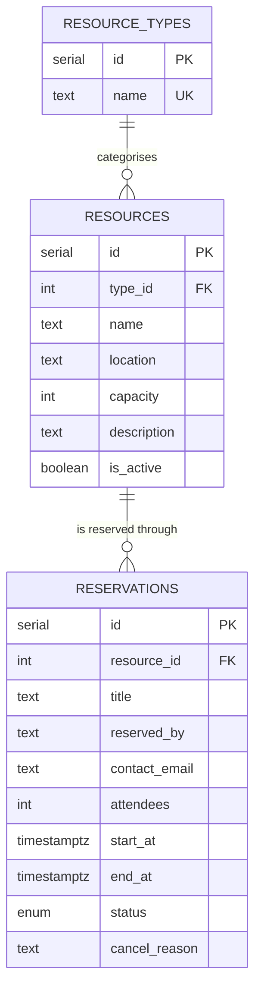

# ReserveHub — Resource Reservation Management System

A full-stack web application that lets an organisation keep its shared resources (meeting rooms,
vehicles, equipment, desks…) in one place, reserve them, and always know what is available.

Built for the PrimeWave Lab Software Engineering Internship technical assessment.

**Stack:** Next.js (App Router) · TypeScript · PostgreSQL · Git/GitHub

---

## 1. The problem and how I interpreted it

> *"Reservations are handled through informal communication and manual records, causing scheduling
> confusion, overlapping reservations, and uncertainty about availability… The solution must remain
> reliable as day-to-day activity grows."*

| Pain point in the scenario | What the application does |
|---|---|
| Resources are not organised | **Resources** with a type, location, capacity and description. Types can be added on the fly. |
| Overlapping reservations | A reservation that overlaps another one for the same resource is **impossible** — enforced by the database itself (see §3), not just by the UI. |
| Scheduling confusion | A **per-resource day timeline**, a global **reservations list** with Upcoming / Past / Cancelled tabs, and live conflict warnings in the booking form. |
| Uncertainty about availability | A **dashboard** showing what is free / in use right now, and a **"Find availability"** page: pick a time window and see every resource that is free for the whole window. |
| "Reliable as activity grows" | Concurrency-safe booking, indexed queries, soft-deletes that preserve history, input validation on the server. |

## 2. Features

- Create / edit / deactivate resources; add resource types
- Reserve a resource for a time range (single or multi-day) with title, owner, contact and attendee count
- Instant conflict detection — live warning while choosing a time, and a clear error naming the clashing booking if it still happens
- Cancel reservations (with optional reason); history is kept, and the slot becomes bookable again
- Day schedule per resource (24 h timeline with a "now" marker, previous/next day navigation)
- Dashboard: active resources, in use now, today's and upcoming reservations, live status per resource
- Availability search by time window, type and minimum capacity
- JSON REST API under `/api` (documented below)

### Business rules (in `src/lib/rules.ts`)
- End must be after start; minimum 15 minutes, maximum 7 days
- Cannot book in the past (5-minute grace) or more than 180 days ahead
- Attendees cannot exceed the resource's capacity
- Inactive resources cannot be booked; a resource with upcoming reservations cannot be deactivated until they are cancelled
- Back-to-back bookings are allowed (10:00–11:00 then 11:00–12:00)
- Already-ended or already-cancelled reservations cannot be cancelled again

## 3. Key engineering decisions

**Double-booking is prevented in the database.** Checking "is it free?" in application code and then
inserting is a classic race condition: two people submitting at the same moment can both pass the
check. Instead, the `reservations` table has a PostgreSQL *exclusion constraint*
(`EXCLUDE USING gist (resource_id WITH =, tstzrange(start_at, end_at, '[)') WITH &&) WHERE (status='confirmed')`).
Postgres guarantees atomically that no two confirmed reservations of one resource overlap. The app
catches the resulting error (`23P01`) and turns it into a friendly `409 Conflict` that names the
clashing reservation. `npm run test:api` fires 12 simultaneous identical requests and verifies that
exactly one succeeds.

**Time zones.** All timestamps are stored as `timestamptz` (UTC). People type and read *wall-clock*
times in the organisation's zone (`ORG_TIMEZONE`, default `Asia/Colombo`), so the API accepts
`YYYY-MM-DDTHH:mm` strings and converts them on the server (`src/lib/time.ts`). The result is the
same no matter which timezone the browser or server is in.

**Soft deletes.** Resources are deactivated, reservations are cancelled — never deleted — so history
and reporting stay intact. Foreign keys use `ON DELETE RESTRICT`.

**Plain SQL + `pg`, no ORM.** The core feature (exclusion constraint on a range) is a Postgres-specific
capability that ORMs do not model well. Using SQL migrations directly keeps the schema explicit and the
behaviour easy to reason about for a project of this size.

**Validation twice.** The browser gives instant feedback; the server (Zod + business rules) is the
source of truth. The database adds a final safety net (CHECK constraints, unique index, exclusion constraint).

**Server Components for reads, REST route handlers for writes.** Pages fetch directly from the data
layer on the server (no client-side loading spinners); forms call the JSON API and refresh.

## 4. Data model

Full diagram with all columns: [`docs/er-diagram.md`](docs/er-diagram.md) (Mermaid, rendered by GitHub).



## 5. Getting started

**Prerequisites:** Node.js 20.6+ and PostgreSQL 14+ (or Docker).

```bash
# 1. Install dependencies
npm install

# 2. Start PostgreSQL (skip if you already have one)
docker compose up -d

# 3. Configure environment
cp .env.example .env        # edit DATABASE_URL if your Postgres differs

# 4. Create the schema and load demo data
npm run db:migrate
npm run db:seed

# 5. Run the app
npm run dev                  # http://localhost:3000
```

Using a local Postgres instead of Docker:
```sql
CREATE USER rrms WITH PASSWORD 'rrms' SUPERUSER;  -- the migration runs CREATE EXTENSION btree_gist
CREATE DATABASE rrms OWNER rrms;
```

### Useful scripts
| Command | What it does |
|---|---|
| `npm run dev` | Development server |
| `npm run build && npm start` | Production build and server |
| `npm run typecheck` | TypeScript check |
| `npm run db:migrate` | Apply pending SQL migrations in `db/migrations` |
| `npm run db:seed` | Insert demo resources and reservations (only if empty) |
| `npm run db:reset` | Drop everything, re-migrate, re-seed |
| `npm run test:api` | End-to-end API tests, including a concurrency test (app must be running) |

## 6. API reference

All responses are JSON: `{ "data": ... }` on success, `{ "error": "message" }` on failure.
Date/times are `YYYY-MM-DDTHH:mm` in the organisation timezone.

| Method & path | Purpose |
|---|---|
| `GET /api/resources?typeId=&q=&includeInactive=` | List resources with live status |
| `POST /api/resources` | Create resource |
| `GET / PATCH /api/resources/:id` | Read / update (also `{ "is_active": false }`) |
| `GET /api/types`, `POST /api/types` | List / create resource types |
| `GET /api/reservations?resourceId=&status=&scope=upcoming\|past\|all&from=&to=` | List reservations |
| `POST /api/reservations` | Create. `409` if the time overlaps (response includes the clashing reservations) |
| `POST /api/reservations/:id/cancel` | Cancel `{ "reason": "..." }` |
| `GET /api/availability?start=&end=[&resourceId=][&typeId=&minCapacity=]` | Free resources for a window, or conflicts for one resource |

Status codes: `400` validation · `404` not found · `409` conflict (overlap, duplicate name, invalid state).

## 7. Project structure

```
db/migrations/001_init.sql   Schema, constraints, indexes
scripts/                     migrate, seed, api-test
src/lib/
  queries.ts                 Data access + business rules
  validation.ts              Zod schemas
  rules.ts                   Business-rule constants
  time.ts                    Timezone handling
src/app/                     Pages (server components) and /api route handlers
src/components/              Forms, timeline, badges (client components where interactive)
```

## 8. Trade-offs and what I would do next

Kept in scope deliberately ("thoughtful prioritisation over unnecessary complexity"):

- **No authentication.** Reservations record *who* they are for as free text. Next step: login (e.g. Auth.js),
  roles (admin manages resources; users manage their own reservations), and "reserved by" linked to a user table.
- **No recurring reservations** (e.g. weekly meeting) — would generate individual rows so the same constraint applies.
- **No editing of a reservation** — cancel and re-book. An edit would be an `UPDATE` protected by the same constraint.
- **No email notifications**, opening-hours or approval workflows.
- Pagination for very large reservation lists (queries are already indexed and limited).
