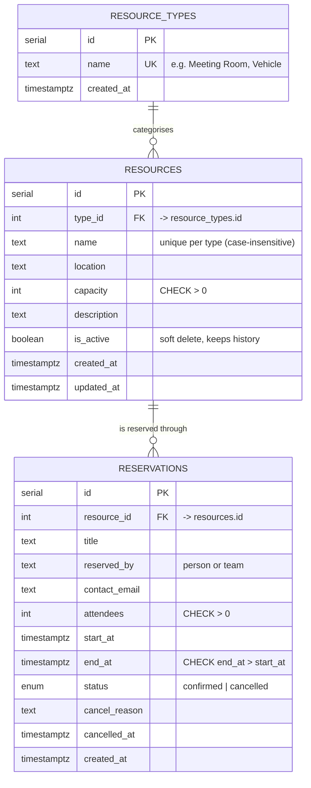

# Entity Relationship Diagram



## The key constraint

`reservations` has a PostgreSQL **exclusion constraint**:

```sql
EXCLUDE USING gist (
  resource_id WITH =,
  tstzrange(start_at, end_at, '[)') WITH &&
) WHERE (status = 'confirmed')
```

Meaning: the same resource can never have two *confirmed* reservations whose time ranges overlap.
Ranges are half-open `[start, end)`, so 10:00–11:00 followed by 11:00–12:00 is allowed.
Cancelled reservations are ignored by the constraint, so a cancelled slot can be booked again.
